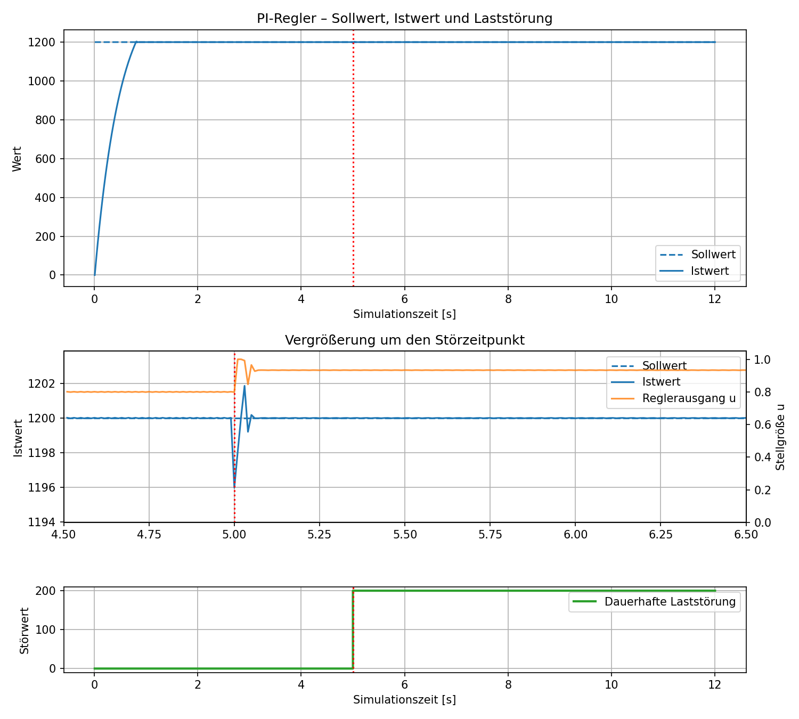
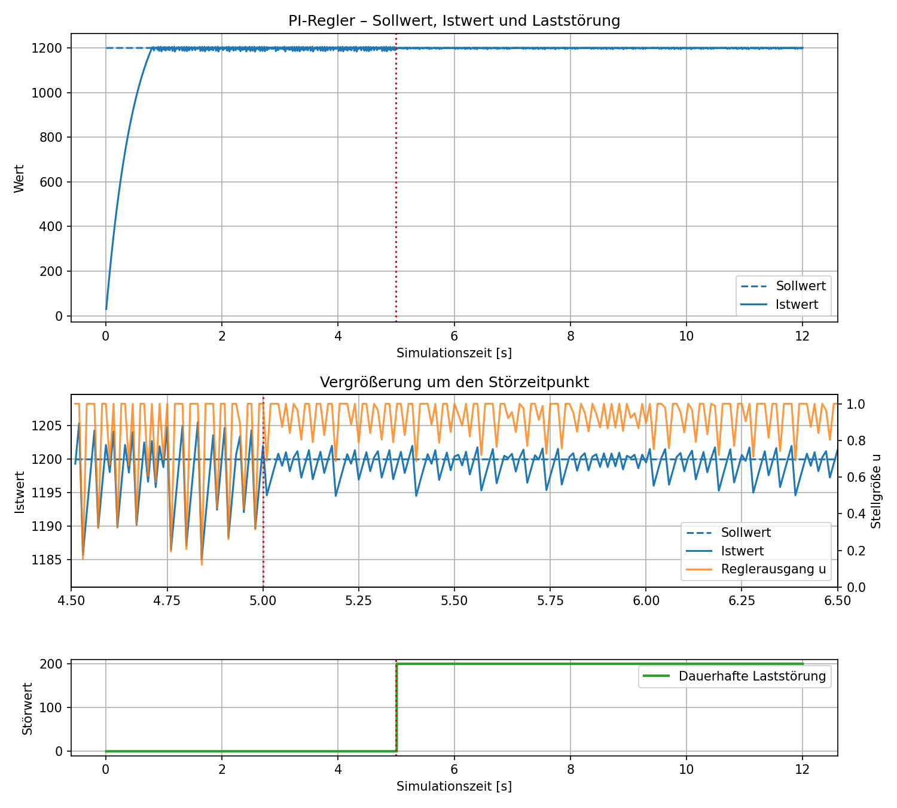
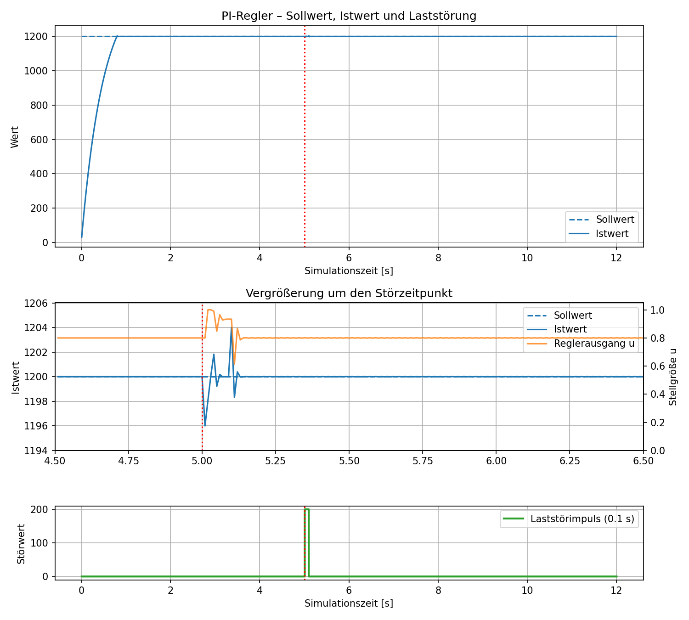

# Technische Auswertung des PI-Regelkreises

## 1. Ziel und Aussagebereich

Dieses Dokument analysiert den PI-Regler auf dem STM32F411RE in Verbindung mit der in Python ausgeführten virtuellen Strecke. Untersucht werden das Streckenmodell, die diskrete Reglerdynamik, die Stabilität im ungesättigten Arbeitspunkt, die gespeicherten Versuchsergebnisse und die beobachteten Verläufe.

Die Auswertung bezieht sich auf das virtuelle Modell und die vorliegenden Softwareläufe. Bei der Einheit U/min handelt es sich lediglich um simulierte Werte, um die Ergebnisse etwas anschaulicher zu machen. Die Firmware läuft auf dem STM32; der Prozesswert wird jedoch durch das Python-Modell berechnet und über UART zurückgeführt.

Bei der Interpretation wird zwischen drei Ebenen unterschieden:

- **Mathematisches Modell:** Aussagen, die sich aus den verwendeten Gleichungen ableiten lassen.
- **Lineare Stabilitätsanalyse:** Aussagen über kleine Abweichungen vom Arbeitspunkt unter vereinfachten Bedingungen.
- **Simulationsergebnisse:** Tatsächlich gespeicherte Werte aus den untersuchten Softwareläufen.

Diese Unterscheidung ist wichtig, da das reale Verhalten der implementierten Simulation durch Stellgrößenbegrenzung, Integratorbegrenzung und die zeitliche Rückführung über UART beeinflusst werden kann.

## 2. Verwendete Projektparameter

| Größe | Symbol | Projektwert |
|---|---:|---:|
| Nominelle Abtastzeit | $T_s$ | 0,01 s (10 ms) |
| Modellierte maximale Drehzahl | $K$ | 1500 U/min |
| Sollwert | $r$ | 1200 U/min |
| Streckenzeitkonstante | $\tau$ | 0,5 s |
| Standard-Proportionalverstärkung | $K_p$ | 0,08 |
| Standard-Integralverstärkung | $K_i$ | 5,0 |
| Begrenzung der Stellgröße | $u$ | 0 bis 1 |
| Back-Calculation-Verstärkung | $K_t$ | $5\,\mathrm{s}^{-1}$ |
| Integratorgrenzen | $I$ | 0 bis 1 |

Die Firmware ruft den Regler nominell im TIM2-Interrupt mit einer Zeitschrittweite von

$$
T_s=0{,}01\,\mathrm{s}
$$

auf.

Die Python-Strecke aktualisiert sich pro empfangenem Timer-Telegramm.
Wenn das Telegramm einen gültigen Wert für die Timerperiode enthält,
wird die Simulationszeit um diese gemessene Periode erhöht.

## 3. Virtuelle Regelstrecke

### 3.1 Modellierung der Strecke

Python bildet eine Strecke erster Ordnung mit einer normierten Stellgröße ab. Die Stellgröße $u_k$ wird zunächst auf einen Zielwert skaliert. Anschließend wird eine gegebenenfalls aktive Laststörung $d_k$ abgezogen. Das Ergebnis wird auf den Bereich von 0 bis 1500 U/min begrenzt.

$$
y_{\mathrm{ziel},k}
=
\operatorname{clip}
\left(1500u_k-d_k,\;0,\;1500\right)
$$

Dabei bezeichnet:

- $u_k$ die normierte Stellgröße zwischen 0 und 1,
- $d_k$ die modellierte Laststörung in U/min,
- $y_{\mathrm{ziel},k}$ den von der Stellgröße vorgegebenen Zielwert.

Der Istwert nähert sich diesem Zielwert pro Zeitschritt mit einer Vorwärts-Euler-Diskretisierung:

$$
y_{k+1}
=
\operatorname{clip}
\left(
y_k+
\frac{T_p}{\tau}
\left(y_{\mathrm{ziel},k}-y_k\right),
\;0,\;1500
\right)
$$

Die Funktion $\operatorname{clip}(x,a,b)$ begrenzt den Wert $x$ auf den Bereich zwischen $a$ und $b$.

Für $T_p=0{,}01\,\mathrm{s}$ und $\tau=0{,}5\,\mathrm{s}$ ergibt sich:

$$
\alpha=\frac{T_p}{\tau}
=\frac{0{,}01}{0{,}5}
=0{,}02
$$

Ohne aktive Störung und solange keine Begrenzung des Istwerts greift, gilt $y_{\mathrm{ziel},k}=1500u_k$. Die Streckengleichung vereinfacht sich damit zu:

$$
y_{k+1}
=
y_k+\alpha(1500u_k-y_k)
$$

Nach Zusammenfassen ergibt sich:

$$
y_{k+1}=0{,}98y_k+30u_k
$$

Pro 10-ms-Schritt legt die Strecke somit 2 % der Differenz zwischen aktuellem Istwert und Zielwert zurück. Die Zeitkonstante $\tau$ beschreibt dabei die Trägheit der virtuellen Strecke, nicht die Abtastzeit des Reglers.

### 3.2 Kontinuierliches Streckenmodell

Das zugehörige kontinuierliche Modell erster Ordnung lautet:

$$
\tau\frac{dy(t)}{dt}+y(t)=Ku(t)
$$

Mit $K=1500$ und $\tau=0{,}5\,\mathrm{s}$ ergibt sich die Übertragungsfunktion:

$$
G(s)=\frac{Y(s)}{U(s)}
=\frac{1500}{0{,}5s+1}
$$

Die Polstelle der kontinuierlichen Strecke ist:

$$
s_p=-\frac{1}{\tau}=-2\,\mathrm{s}^{-1}
$$

Die Polstelle liegt in der linken Halbebene. Die kontinuierliche Strecke erster Ordnung ist damit stabil.

Für das diskrete Modell ergibt sich aus der Rekursionsgleichung:

$$
G(z)=\frac{30}{z-0{,}98}
$$

Die diskrete Polstelle lautet:

$$
z_p=0{,}98
$$

Da $|z_p|<1$ gilt, ist auch das diskrete Streckenmodell stabil. Ohne Rückkopplung nähert sich der Istwert bei konstanter Stellgröße dem Zielwert an.

### 3.3 Stationärer Arbeitspunkt

Für einen Sollwert von 1200 U/min muss im störungsfreien stationären Zustand gelten:

$$
u^*=\frac{1200}{1500}=0{,}8
$$

Der Sollwert entspricht somit 80 % der maximal modellierten Drehzahl.

Im stationären Zustand ist der Regelfehler null:

$$
e^*=r-y^*=1200-1200=0
$$

Da der Proportionalanteil bei einem Fehler von null verschwindet, muss der Integrator die erforderliche Stellgröße bereitstellen:

$$
I^*=u^*=0{,}8
$$

Dieser Arbeitspunkt liegt innerhalb der Stellgrößen- und Integratorgrenzen. Er ist damit grundsätzlich mit der implementierten Begrenzung vereinbar.

## 4. PI-Regler und Anti-Windup

### 4.1 Berechnung der Stellgröße

Die Firmware berechnet zunächst den Regelfehler:

$$
e_k=r-y_k
$$

Die unbeschränkte Stellgröße ergibt sich aus dem Proportionalanteil und dem aktuellen Integratorzustand:

$$
u_{\mathrm{raw},k}=K_pe_k+I_k
$$

Anschließend wird die Stellgröße auf den zulässigen Bereich begrenzt:

$$
u_k=\operatorname{clip}(u_{\mathrm{raw},k},0,1)
$$

Die tatsächliche Stellgröße kann somit weder negativ werden noch größer als 1 sein.

### 4.2 Aktualisierung des Integrators

Nach der Begrenzung der Stellgröße aktualisiert die Firmware den Integrator. In der verwendeten Back-Calculation-Struktur lautet die Gleichung:

$$
I_{k+1}
=
\operatorname{clip}
\left[
I_k+T_s
\left(
K_ie_k+K_t(u_k-u_{\mathrm{raw},k})
\right),
\;0,\;1
\right]
$$

Die Gleichung enthält zwei Beiträge:

1. **Integration des Regelfehlers:** $K_ie_k$ verändert den Integrator entsprechend dem aktuellen Fehler.
2. **Back-Calculation-Korrektur:** $K_t(u_k-u_{\mathrm{raw},k})$ korrigiert den Integrator anhand der Differenz zwischen begrenzter und unbeschränkter Stellgröße.

Wenn die Stellgröße nicht gesättigt ist, gilt:

$$
u_k=u_{\mathrm{raw},k}
$$

Damit verschwindet der Back-Calculation-Term:

$$
K_t(u_k-u_{\mathrm{raw},k})=0
$$

Bei oberer Sättigung ist $u_k=1$ und $u_{\mathrm{raw},k}>1$. Daraus folgt:

$$
u_k-u_{\mathrm{raw},k}<0
$$

Der Korrekturterm wirkt in diesem Fall dem weiteren Aufladen des Integrators entgegen. Bei unterer Sättigung ist $u_k=0$ und $u_{\mathrm{raw},k}<0$. Dann ist die Differenz positiv.

Zusätzlich wird der Integrator direkt auf den Bereich $[0,1]$ begrenzt. Diese Begrenzung ist von der Back-Calculation-Korrektur zu unterscheiden: Back-Calculation wirkt auf die Integratordynamik, während der Clamp den zulässigen Wertebereich des Integrators unmittelbar erzwingt.

### 4.3 Tracking-Zeitkonstante

Die Back-Calculation-Verstärkung beträgt:

$$
K_t=5\,\mathrm{s}^{-1}
$$

Die zugehörige Tracking-Zeitkonstante ist:

$$
T_t=\frac{1}{K_t}
=\frac{1}{5}
=0{,}2\,\mathrm{s}
$$

Bei einer Reglerabtastzeit von 10 ms ergibt sich der dimensionslose Faktor:

$$
K_tT_s=5\cdot0{,}01=0{,}05
$$

Die Korrektur erfolgt daher schrittweise. Die Tracking-Zeitkonstante ist ein Parametrierungswert und stellt für sich genommen keine Garantie für einen stabilen Regelkreis dar.

**Wichtig:** Anti-Windup ist keine automatische Reglereinstellung. Im Projekt bleiben $K_p$, $K_i$ und $K_t$ während eines Laufs konstant. Die Gains können vor einem Lauf per UART gesetzt werden; dabei setzt die Firmware den Integrator auf null.

Anti-Windup soll primär verhindern, dass der Integrator während einer Stellgrößensättigung unkontrolliert weiter anwächst. Da der Back-Calculation-Term im ungesättigten Bereich null ist, verändert er die lokale lineare Dynamik dort nicht. Eine ungeeignete Gain-Kombination wird dadurch nicht automatisch stabil.

## 5. Wirkung der Reglerparameter

### 5.1 Proportionalanteil

Der Proportionalanteil reagiert unmittelbar auf den aktuellen Regelfehler:

$$
u_{P,k}=K_pe_k
$$

Bei $K_p=0{,}08$ erzeugt bereits ein Fehler von 1 U/min einen Proportionalanteil von 0,08. Auf die virtuelle Strecke skaliert entspricht dies einer Änderung des unbeschränkten Zielwerts um:

$$
\Delta y_{\mathrm{ziel}}
=1500\cdot0{,}08
=120\,\mathrm{U/min}
$$

Bei $K_p=0{,}16$ verdoppelt sich diese Wirkung:

$$
\Delta y_{\mathrm{ziel}}
=1500\cdot0{,}16
=240\,\mathrm{U/min}
$$

Diese Zahlen beschreiben die Wirkung des Proportionalanteils auf die unbeschränkte Stellgröße. Sie bedeuten nicht, dass sich die tatsächliche Drehzahl innerhalb eines einzigen Abtastschritts um diesen Betrag ändert. Die Trägheit der Strecke begrenzt die tatsächliche Änderung des Istwerts.

Die hohe Verstärkung kann allerdings dazu führen, dass die unbeschränkte Stellgröße bereits bei kleinen Fehlern die Grenzen 0 oder 1 erreicht.

### 5.2 Integralanteil

Der Integralanteil summiert den Regelfehler über die Zeit. Bei einem konstanten Fehler von 1 U/min beträgt die Änderung des Integrators pro 10-ms-Schritt – ohne Sättigungs- und Anti-Windup-Korrektur –:

$$
\Delta I=K_i e_kT_s
$$

Mit $e_k=1\,\mathrm{U/min}$ und $T_s=0{,}01\,\mathrm{s}$ ergibt sich:

| $K_i$ | Änderung von $I$ pro Tick | Änderung des skalierten Zielwerts |
|---:|---:|---:|
| 2,5 | 0,025 | 37,5 U/min pro Tick |
| 5 | 0,05 | 75 U/min pro Tick |
| 10 | 0,10 | 150 U/min pro Tick |

Die Tabelle zeigt die Wirkung des Integrators bei einem Fehler von 1 U/min und ohne zusätzliche Korrektur. Sie gilt nur, solange die Begrenzungen und die Back-Calculation den Integrator nicht zusätzlich beeinflussen.

Ein höheres $K_i$ baut einen anhaltenden Fehler schneller ab, kann aber auch größere Änderungen der Stellgröße pro Abtastschritt erzeugen. Ein höheres $K_p$ verstärkt die unmittelbare Reaktion auf den Fehler und kann die Stellgröße schneller in die Sättigung bringen.

Die Wirkung beider Parameter ist gekoppelt. Deshalb genügt es nicht, die Proportional- und Integralverstärkung unabhängig voneinander anhand ihrer jeweiligen Wirkung zu bewerten. Für die diskrete Regelung müssen die Parameter gemeinsam betrachtet werden.

## 6. Diskrete Stabilitätsanalyse am Arbeitspunkt

### 6.1 Annahmen und lineares Modell

Eine Stabilitätsaussage hängt vom Streckenmodell, der Abtastung, der Reglerimplementierung und den Begrenzungen ab.

Für die folgende Gain-Grenze wird zunächst das lokale, ungesättigte Modell ohne zusätzliche UART- oder PC-Verzögerung betrachtet. Die Stellgrößenbegrenzung und die Integratorbegrenzung werden für diese lineare Analyse weggelassen. Es handelt sich daher um eine lokale Kleinsignal-Aussage und nicht um eine globale Stabilitätsgarantie für das vollständige nichtlineare System.

Für die Rechnung wird angenommen:

$$
T_p=T_s=0{,}01\,\mathrm{s}
$$

Die diskrete Strecke lautet dann:

$$
y_{k+1}=(1-\alpha)y_k+\alpha Ku_k
$$

mit:

$$
\alpha=\frac{T_p}{\tau}=0{,}02,
\qquad K=1500
$$

Im ungesättigten Zustand gilt für den PI-Regler:

$$
u_k=K_pe_k+I_k
$$

mit:

$$
e_k=r-y_k
$$

Der Integrator wird gemäß folgender Gleichung aktualisiert:

$$
I_{k+1}=I_k+K_iT_se_k
$$

Für die Stabilitätsanalyse werden Abweichungen vom stationären Arbeitspunkt definiert:

$$
x_k=y_k-r
$$

$$
i_k=I_k-I^*
$$

Da der Sollwert konstant ist, entspricht die Abweichung des Regelfehlers dem negativen Abweichungswert des Istwerts:

$$
e_k=-x_k
$$

Einsetzen in die Streckengleichung ergibt:

$$
x_{k+1}
=
\left[1-\alpha(1+KK_p)\right]x_k
+\alpha K i_k
$$

Für den Integrator folgt:

$$
i_{k+1}=i_k-K_iT_sx_k
$$

Zusammengefasst ergibt sich das lineare Zustandsraummodell:

$$
\begin{bmatrix}
x_{k+1}\\
i_{k+1}
\end{bmatrix}
=
\underbrace{
\begin{bmatrix}
1-\alpha(1+KK_p) & \alpha K\\
-K_iT_s & 1
\end{bmatrix}
}_{A}
\begin{bmatrix}
x_k\\
i_k
\end{bmatrix}
$$

Die Eigenwerte der Matrix $A$ sind die Pole des linearen geschlossenen Regelkreises. Für asymptotische Stabilität müssen beide Pole innerhalb des Einheitskreises liegen:

$$
|z_1|<1
\qquad\text{und}\qquad
|z_2|<1
$$

### 6.2 Charakteristisches Polynom

Die charakteristische Gleichung ergibt sich aus:

$$
\det(zI-A)=0
$$

Nach Einsetzen und Zusammenfassen folgt:

$$
z^2
-\left[2-\alpha(1+KK_p)\right]z
+1-\alpha(1+KK_p)+\alpha KK_iT_s
=0
$$

Mit $\alpha=0{,}02$, $K=1500$ und $T_s=0{,}01\,\mathrm{s}$ vereinfacht sich das Polynom zu:

$$
\boxed{
z^2-(1{,}98-30K_p)z
+0{,}98-30K_p+0{,}3K_i=0
}
$$

Dieses Polynom beschreibt die lokale lineare Dynamik des geschlossenen Kreises unter den genannten Annahmen.

### 6.3 Stabilitätsbedingungen nach dem Jury-Kriterium

Für ein diskretes Polynom zweiter Ordnung müssen die Jury-Bedingungen erfüllt sein, damit beide Pole innerhalb des Einheitskreises liegen.

Angewendet auf das charakteristische Polynom ergeben sich die folgenden Bedingungen:

$$
K_i>0
$$

$$
K_i>200K_p-13{,}2
$$

$$
K_i<100K_p+0{,}0667
$$

Damit ergibt sich für positive Integralverstärkungen der folgende stabile Bereich:

$$
\boxed{
\max(0,\;200K_p-13{,}2)
<K_i<
100K_p+0{,}0667
}
$$

Die Grenzen sind strikt. Ein Gain genau auf einer Grenze erfüllt die Bedingungen für asymptotische Stabilität nicht.

Die beiden Grenzen müssen gleichzeitig erfüllt sein. Ein positiver Integralanteil allein ist daher kein ausreichender Stabilitätsnachweis.

### 6.4 Stabilitätsbereiche für die untersuchten $K_p$-Werte

| $K_p$ | Lokaler stabiler Bereich für $K_i$ | Einordnung |
|---:|---:|---|
| 0,04 | $0<K_i<4{,}067$ | $K_i=5$ liegt oberhalb des Bereichs |
| 0,08 | $2{,}800<K_i<8{,}067$ | $K_i=5$ liegt im Bereich; 2,5 und 10 liegen außerhalb |
| 0,085 | $3{,}800<K_i<8{,}567$ | $K_i=5$ liegt im Bereich |
| 0,16 | kein möglicher $K_i$-Bereich | Die untere Grenze liegt über der oberen |

Beim betrachteten Zeitraster ist der lokale lineare Stabilitätsbereich für $K_p=0{,}16$ leer. Die Bedingungen an die beiden diskreten Pole können für keinen positiven Wert von $K_i$ gleichzeitig erfüllt werden.

Der höchste $K_p$-Wert, für den die untere Grenze noch unter der oberen Grenze liegt, ergibt sich aus:

$$
200K_p-13{,}2<100K_p+0{,}0667
$$

Daraus folgt näherungsweise:

$$
K_p<0{,}1327
$$

Diese Grenze gilt ausschließlich für das hier verwendete Streckenmodell, die angenommene Abtastzeit und die betrachtete PI-Implementierung. Sie ist kein allgemeiner Grenzwert für PI-Regler.

### 6.5 Vergleich mit dem kontinuierlichen Modell

Zum Vergleich wird die kontinuierliche Strecke mit einem idealen kontinuierlichen PI-Regler betrachtet. Die Reglerübertragungsfunktion lautet:

$$
C(s)=K_p+\frac{K_i}{s}
=\frac{K_ps+K_i}{s}
$$

Für den geschlossenen Kreis ergibt sich die charakteristische Gleichung:

$$
1+C(s)G(s)=0
$$

Nach Einsetzen der kontinuierlichen Übertragungsfunktionen folgt:

$$
0{,}5s^2+(1+1500K_p)s+1500K_i=0
$$

Für positive Werte von $K_p$ und $K_i$ sind bei diesem idealisierten kontinuierlichen Modell alle Koeffizienten positiv. Das kontinuierliche Modell ist damit für positive Verstärkungen stabil.

Die diskrete Stabilitätsgrenze entsteht hier durch die konkrete diskrete Aktualisierung von Strecke und Regler. Der Vergleich zeigt, dass sich Stabilitätsaussagen aus einem kontinuierlichen Modell nicht ohne Weiteres auf die tatsächlich implementierte diskrete Regelung übertragen lassen.

### 6.6 Berechnete Pole ausgewählter Parameterkombinationen

Für den Standardfall $K_p=0{,}08$ und $K_i=5$ ergibt sich das charakteristische Polynom:

$$
z^2+0{,}42z+0{,}08=0
$$

Die beiden Pole lauten näherungsweise:

$$
z_{1,2}=-0{,}210\pm0{,}189j
$$

Ihr Betrag beträgt:

$$
|z_{1,2}|\approx0{,}283
$$

Beide Pole liegen innerhalb des Einheitskreises. Das lokale lineare Modell sagt für diese Parameterkombination somit asymptotisch abklingende Abweichungen voraus.

Für $K_p=0{,}08$ und $K_i=2{,}5$ ergibt sich:

$$
z^2+0{,}42z-0{,}67=0
$$

Die Pole liegen näherungsweise bei:

$$
z_1\approx0{,}635,
\qquad
z_2\approx-1{,}055
$$

Da ein Pol einen Betrag größer als 1 besitzt, ist diese Parameterkombination im betrachteten linearen Modell instabil.

Für $K_p=0{,}08$ und $K_i=10$ ergibt sich:

$$
z^2+0{,}42z+1{,}58=0
$$

Die Pole sind komplex konjugiert. Ihr gemeinsamer Betrag beträgt:

$$
|z_{1,2}|=\sqrt{1{,}58}\approx1{,}257
$$

Auch diese Kombination ist im betrachteten linearen Modell instabil.

Die berechneten Pole beschreiben die lokale Dynamik ohne Sättigung und ohne zusätzliche Rückführungsverzögerung. Sie liefern deshalb eine Erklärung für die unterschiedliche Stabilität der untersuchten Parameterkombinationen, bestimmen aber nicht allein die genaue Amplitude oder Periodendauer einer Schwingung im begrenzten Gesamtsystem.

## 7. Vergleich mit gespeicherten Läufen

Die ausgewerteten Störversuche verwenden eine Amplitude von 200 U/min.
Untersucht werden ein dauerhafter Sprung ab 5 s und ein 0,1-s-Impuls ab
5 s. Für den Vergleich der Reglerparameter bleibt die Störhöhe
unverändert; variiert wird jeweils nur eine Reglerverstärkung.

### 7.1 Dauerstörung mit $K_p=0{,}08$ und $K_p=0{,}16$

Die folgende Gegenüberstellung verwendet in beiden Läufen
$K_i=5$, $\tau=0{,}5$ s, einen Sollwert von 1200 U/min und dieselbe
dauerhafte Störung von 200 U/min. Damit ist $K_p$ die einzige geänderte
Reglergröße.

<table>
<tr>
<th>Basis: Kp = 0,08, Ki = 5</th>
<th>Erhöhtes Kp: Kp = 0,16, Ki = 5</th>
</tr>
<tr>
<td></td>
<td></td>
</tr>
</table>

Beim Basisregler ist nach der Störung eine kurze Abweichung erkennbar;
danach liegt der Istwert nahe beim Sollwert. Beim Lauf mit
$K_p=0{,}16$ ist bereits vor dem Störzeitpunkt eine deutlich größere
periodische Schwankung sichtbar, die nach dem Störsprung fortbesteht.
Die Störung verstärkt somit die Abweichung kurzfristig, ist aber nicht
der alleinige Ursprung dieser Schwingung.

| $K_p$ | $K_i$ | Istwert-Bereich 4,5–6,5 s | Spitze-Spitze 10–12 s | Stellgröße 4,5–6,5 s |
|---:|---:|---:|---:|---:|
| 0,08 | 5 | 1195,98–1201,86 U/min | 0,019 U/min | 0,7989–1,0000 |
| 0,16 | 5 | 1185,03–1205,49 U/min | 7,447 U/min | 0,1216–1,0000 |

Beim Basisregler steigt die Stellgröße nach dem Störsprung
vorübergehend bis zur oberen Grenze 1. Im letzten 2-s-Fenster liegt
sie bei ungefähr 0,933. Das entspricht der stationären Bilanz:

$$
u^*=\frac{r+d}{K}
=\frac{1200+200}{1500}
\approx0{,}933
$$

Der Sollwert bleibt damit rechnerisch erreichbar, der Arbeitspunkt
liegt aber näher an der Stellgrößengrenze als ohne Störung.

### 7.2 Einfluss von $K_i$ bei derselben Dauerstörung

Bei festem $K_p=0{,}08$ und gleicher dauerhafter Störung von
200 U/min wurden drei Integralverstärkungen verglichen:

| $K_i$ | Stabilitätsanalyse am Arbeitspunkt | Spitze-Spitze 10–12 s |
|---:|---|---:|
| 2,5 | außerhalb des berechneten lokalen Stabilitätsbereichs | 2,152 U/min |
| 5 | innerhalb des berechneten lokalen Stabilitätsbereichs | 0,019 U/min |
| 10 | außerhalb des berechneten lokalen Stabilitätsbereichs | 4,197 U/min |

Die nichtlineare Simulation muss nicht die unbegrenzt anwachsende
Antwort des linearen Modells zeigen. Anti-Windup, Integrator-Clamp und
Stellgrößenbegrenzung verändern den Verlauf. Die Messwerte sind daher
Ergebnisse des vollständigen Simulationskreises; die Polanalyse liefert
eine lokale lineare Einordnung.

### 7.3 Impulsstörung mit Amplitude 200 U/min

Beim 0,1-s-Impuls mit dem Basisregler ($K_p=0{,}08$, $K_i=5$) liegt
der Istwert im Zeitfenster 4,5–6,5 s zwischen 1196,00 und 1204,01 U/min.
Die Stellgröße reicht in diesem Fenster von 0,6127 bis 1,0. Im
Zeitfenster 10–12 s beträgt die Istwert-Spitze-Spitze-Schwankung rund
0,033 U/min; die Antwort klingt im vorliegenden Lauf nach dem Impuls
weitgehend ab.

Wegen des diskreten 10-ms-Rasters wird ein Impuls von 0,1 s als
ungefähr 9 bis 10 aktive Messschritte abgebildet. Die genaue Zahl hängt
von der Lage des Start- und Endzeitpunkts relativ zu den
Simulationsschritten ab.

### 7.4 Kennwerte und Interpretation

Die gespeicherte `settling_time_s` wird ab dem anfänglichen
Sollwertsprung berechnet. Sie beschreibt **nicht** die Erholzeit nach
dem Störzeitpunkt bei 5 s. Für die Störantwort sind deshalb die
Zeitreihen nach 5 s und die stationäre Spitze-Spitze-Schwankung im
Fenster 10–12 s aussagekräftiger. Die CSV enthält die begrenzte
Stellgröße, nicht den internen unbeschränkten PI-Ausgang.

Die dargestellten Werte stammen aus einzelnen gespeicherten Läufen.
Wiederholungen wären erforderlich, um eine Streuung zwischen Läufen
quantitativ zu bewerten.

### Gespeicherte Datensätze

- [Dauerstörung, Basisregler: Plot](python/results/default/persistent_200/plot.png),
  [run.json](python/results/default/persistent_200/run.json) und
  [measurements.csv](python/results/default/persistent_200/measurements.csv)
- [Dauerstörung, $K_p=0{,}16$: Plot](python/results/proportional/0.16/persistent_200/plot.png),
  [run.json](python/results/proportional/0.16/persistent_200/run.json) und
  [measurements.csv](python/results/proportional/0.16/persistent_200/measurements.csv)
- [Impulsstörung, Basisregler: Plot](python/results/default/pulse_200/plot.png),
  [run.json](python/results/default/pulse_200/run.json) und
  [measurements.csv](python/results/default/pulse_200/measurements.csv)

## 8. Woher kommen die sägezahnartigen Verläufe?

In den Messreihen mit einer Laststörung von 200 U/min zeigt der
Basisregler eine kurze Störantwort und anschließend einen nahezu
stationären Verlauf. Beim Vergleichslauf mit $K_p=0{,}16$ treten
hingegen bereits vor der Störung deutliche Schwankungen auf; sie bleiben
nach dem Störsprung bestehen. Die Laststörung ist für diese
Schwingungen somit nicht die alleinige Ursache.

Das Muster ist mit einer diskreten Regelschleife vereinbar, deren
Parameter für die konkrete Abtastung und Streckendynamik ungünstig
gewählt sind. Aus den Zeitreihen allein lässt sich jedoch nicht
eindeutig bestimmen, welcher einzelne Mechanismus den Verlauf
verursacht.

### 8.1 Große Wirkung schon bei kleinen Fehlern

Die proportionale Stellgrößenänderung wird über die Skalierung von 1500 U/min auf die virtuelle Strecke übertragen. Bei $K_p=0{,}08$ entspricht eine Fehleränderung von 1 U/min einer Änderung des unbeschränkten Zielwerts um:

$$
1500\cdot0{,}08=120\,\mathrm{U/min}
$$

Bei $K_p=0{,}16$ sind es:

$$
1500\cdot0{,}16=240\,\mathrm{U/min}
$$

Der Regler reagiert dadurch bereits auf kleine Fehler mit einer vergleichsweise großen Änderung seiner unbeschränkten Stellgröße. Wenn diese die zulässigen Grenzen überschreitet, wird die tatsächliche Stellgröße auf 0 oder 1 begrenzt.

### 8.2 Unterschied zwischen Reglertakt und Streckendynamik

Pro 10-ms-Schritt bewegt sich die virtuelle Strecke nur um 2 % der Differenz zwischen aktuellem Istwert und Zielwert. Die Strecke reagiert damit deutlich träger als eine unmittelbar veränderte Stellgröße.

Der Regler kann seine Stellgröße innerhalb eines Abtastschritts stark verändern, während der Istwert nur einen Teil der dadurch verursachten Differenz zurücklegt. Bei ungünstiger Parametrierung kann dies Überkorrekturen begünstigen.

### 8.3 Abtastung und Rückführung über UART

Die Stellgröße wird taktweise aktualisiert. Der Istwert wird in Python berechnet und über UART an den STM32 zurückgeführt. Der Regler verarbeitet somit einen Messwert, dessen Aktualisierung an die Kommunikation zwischen Mikrocontroller und PC gekoppelt ist.

Eine zusätzliche Verzögerung zwischen Stellgrößenberechnung, Python-Aktualisierung und Rückübertragung kann die Dynamik des geschlossenen Kreises verändern. Eine solche Verzögerung kann die Stabilitätsreserve verringern, sofern sie tatsächlich in relevantem Umfang auftritt.

Die DWT-Zyklen können zur Prüfung des TIM2-Intervalls dienen. Sie messen jedoch nicht automatisch die gesamte Ende-zu-Ende-Zeit von der Berechnung der Stellgröße bis zum Eingang des nächsten zugehörigen Messwerts. Ohne eine gesonderte Zeitmessung sollte der Einfluss der UART-/PC-Verzögerung daher als möglicher Einflussfaktor und nicht als nachgewiesene Hauptursache eingeordnet werden.

### 8.4 Einfluss der Stellgrößen- und Integratorbegrenzung

Wenn die unbeschränkte Stellgröße die Grenzen überschreitet, wird sie auf den zulässigen Bereich begrenzt:

$$
u_k=\operatorname{clip}(u_{\mathrm{raw},k},0,1)
$$

Gleichzeitig wirken die Back-Calculation-Korrektur und die direkte Begrenzung des Integrators. Das vollständige System ist dadurch nichtlinear.

Die lineare Stabilitätsanalyse beschreibt nur den ungesättigten Arbeitspunkt. Wenn die Stellgröße wiederholt zwischen den Grenzen pendelt, gilt die lineare Näherung nicht mehr für den gesamten Verlauf. Die Begrenzungen können dann das Wachstum der Zustände begrenzen und einen anhaltenden Schwingungsverlauf ermöglichen.

Ein sägezahnartiger Verlauf von Stellgröße und Istwert ist mit einem solchen Wechsel zwischen Überkorrektur, Sättigung und Gegenkorrektur vereinbar. Die genaue Periodendauer und Amplitude müssen jedoch aus den Messdaten oder einer Simulation des vollständigen nichtlinearen Systems bestimmt werden.

### 8.5 Einfluss der Messwertauflösung

Der an den STM32 gesendete Messwert wird auf zwei Nachkommastellen gerundet. Diese Auflösung entspricht bei der Drehzahlmessung einer Schrittweite von 0,01 U/min.

Im $K_p=0{,}16$-Lauf beträgt die Spitze-Spitze-Schwankung im Zeitfenster
10–12 s rund 7,45 U/min. Sie liegt deutlich über der
Messwertschrittweite von 0,01 U/min. Die Messwertauflösung allein
erklärt daher nicht die beobachtete Schwankung. Sie kann allerdings
feinere Bewegungen und das Verhalten nahe einem stationären Zustand
beeinflussen.

### 8.6 Zusammenfassende Einordnung

Die vorliegenden Ergebnisse mit Störamplitude 200 U/min zeigen, dass
der Verlauf von der Reglereinstellung abhängt. Der Basisregler
$K_p=0{,}08,\;K_i=5$ erholt sich im persistenten Störversuch weitgehend,
während der Vergleichslauf mit $K_p=0{,}16,\;K_i=5$ stärkere
Schwankungen zeigt. Da diese bereits vor dem Störzeitpunkt auftreten,
lassen sie sich nicht allein durch den Lastsprung erklären. Die lokale
Stabilitätsanalyse liefert eine modellbasierte Einordnung dieses
Unterschieds.

Die genaue Ursache des vollständigen zeitlichen Verlaufs kann jedoch nicht ausschließlich aus den berechneten Polen abgeleitet werden. Für eine eindeutige Zuordnung wären insbesondere die synchronisierten Zeitreihen von Stellgröße und Istwert sowie eine Messung der Ende-zu-Ende-Verzögerung hilfreich.

Das nominelle Timerintervall legt den Rechentakt fest. Abweichungen in der Rückführung, die Dynamik der Strecke, die gewählten Reglerparameter und die nichtlinearen Begrenzungen müssen bei der Interpretation gemeinsam betrachtet werden.

## 9. Einordnung des Anti-Windup und der Regleranpassung

Die Back-Calculation passt grundsätzlich zur Projektstruktur, da die Stellgröße auf $[0,1]$ begrenzt ist. Ohne Anti-Windup könnte der Integrator während einer länger andauernden Sättigung weiter in Richtung des Regelfehlers anwachsen. Nach dem Verlassen der Sättigung müsste der aufgelaufene Integratorwert zunächst abgebaut werden. Dies kann die Erholung verzögern und zusätzliches Überschwingen verursachen.

Die Rückführung

$$
K_t(u_k-u_{\mathrm{raw},k})
$$

korrigiert den Integrator bereits während der Sättigung in Richtung der tatsächlich verfügbaren Stellgröße. Der direkte Integrator-Clamp bei 0 und 1 ist eine zusätzliche Sicherung.

Beide Mechanismen behandeln den Integratorzustand. Sie sind jedoch kein Ersatz für eine passende Parametrierung und beseitigen nicht automatisch eine Instabilität, die im ungesättigten linearen Modell auftritt.

Das Ändern von $K_p$ oder $K_i$ über `SET_PI` ist eine manuelle Parametrierung vor einem Lauf und keine adaptive Regelung. Die Firmware setzt beim Empfang des Befehls den Integrator auf null. Dadurch startet ein neuer Versuch mit einem definierten internen Integratorzustand. Ein Gain-Wechsel während eines bereits laufenden Prozesses kann hingegen einen Übergangseffekt erzeugen.

Für einen aussagekräftigen Vergleich sollten die Parameter daher vor dem jeweiligen Lauf festgelegt und die übrigen Randbedingungen möglichst konstant gehalten werden.

## 10. Schlussfolgerung

Für die dokumentierten Standardbedingungen

$$
T_s=T_p=10\,\mathrm{ms},
\qquad
\tau=0{,}5\,\mathrm{s},
\qquad
K=1500
$$

liegt die Kombination

$$
K_p=0{,}08,\qquad K_i=5
$$

im berechneten lokalen Stabilitätsbereich des vereinfachten diskreten Modells. Dies stimmt mit dem berichteten ruhigen Basislauf überein.

Bei den ausgewerteten Dauerstörversuchen mit 200 U/min lagen die
stationären Spitze-Spitze-Schwankungen im Fenster 10–12 s bei
0,019 U/min für den Basisregler, 2,152 U/min für $K_i=2{,}5$,
4,197 U/min für $K_i=10$, 4,867 U/min für $K_p=0{,}04$ und
7,447 U/min für $K_p=0{,}16$. Diese Werte stammen jeweils aus einem
einzelnen Lauf und sollten nicht als statistische Streuungsanalyse
verstanden werden.

Die untersuchten Kombinationen

$$
K_p=0{,}08,\qquad K_i=2{,}5
$$

$$
K_p=0{,}08,\qquad K_i=10
$$

$$
K_p=0{,}04,\qquad K_i=5
$$

liegen nach dem vereinfachten diskreten Modell außerhalb des stabilen Bereichs. Für $K_p=0{,}16$ existiert unter den getroffenen Annahmen kein stabiler Bereich für $K_i$. Die ausgewerteten CSV-Kennwerte der 200-U/min-Dauerstörversuche zeigen bei diesen Kombinationen größere stationäre Schwankungen als beim Basisregler.

Die Ergebnisse verdeutlichen den Unterschied zwischen einem kontinuierlichen PI-Modell und einer tatsächlich diskret aktualisierten Regelung. Abtastzeit, Streckendynamik, Reglerparameter, Rückführungsverzögerung und Begrenzungen beeinflussen gemeinsam das Verhalten des geschlossenen Kreises.

Die Back-Calculation begrenzt das Auflaufen des Integrators und unterstützt die Erholung aus der Sättigung. Sie macht eine ungeeignete Gain-Kombination jedoch nicht automatisch stabil.

Die Stabilitätsgrenzen sind als modellbasierte Orientierung zu verstehen. Sie gelten für die verwendeten Parameter und die angenommenen Zeitschrittweiten. Wenn sich die Zeitschrittweite der Python-Strecke, die Prozessskalierung, die Zeitkonstante oder die Reglerimplementierung ändert, muss die Stabilitätsanalyse erneut durchgeführt werden.

Für eine belastbare Fortsetzung bieten sich folgende Schritte an:

- Die stationäre Spitze-Spitze-Amplitude oder Standardabweichung zusätzlich in `run.json` aufnehmen.
- Die Ende-zu-Ende-Zeit vom TIM2-Telegramm bis zum nächsten empfangenen Messwert protokollieren.
- Die tatsächliche Zeitschrittweite der Python-Strecke mit der Integrationszeitschrittweite der Firmware vergleichen.
- Gain-Vergleiche zunächst im vorhergesagten stabilen Bereich durchführen und pro Versuchsreihe nur einen Parameter ändern.
- Die Stabilitätsaussage erneut berechnen, wenn Zeitkonstante, Prozessskalierung, Abtastzeit oder Reglerimplementierung geändert werden.
- Bei auffälligen Verläufen die Zeitreihen von Sollwert, Istwert, unbeschränkter Stellgröße, begrenzter Stellgröße und Integrator gemeinsam auswerten.

## Quellen im Projekt

- [Python-Streckenmodell und Auswertung](python/main.py)
- [STM32-PI-Regler und TIM2-Callback](STM32_PI_Controller/Core/Src/main.c)
- Die im Abschnitt 7 verlinkten CSV- und JSON-Dateien enthalten die jeweiligen Messreihen und Konfigurationen.